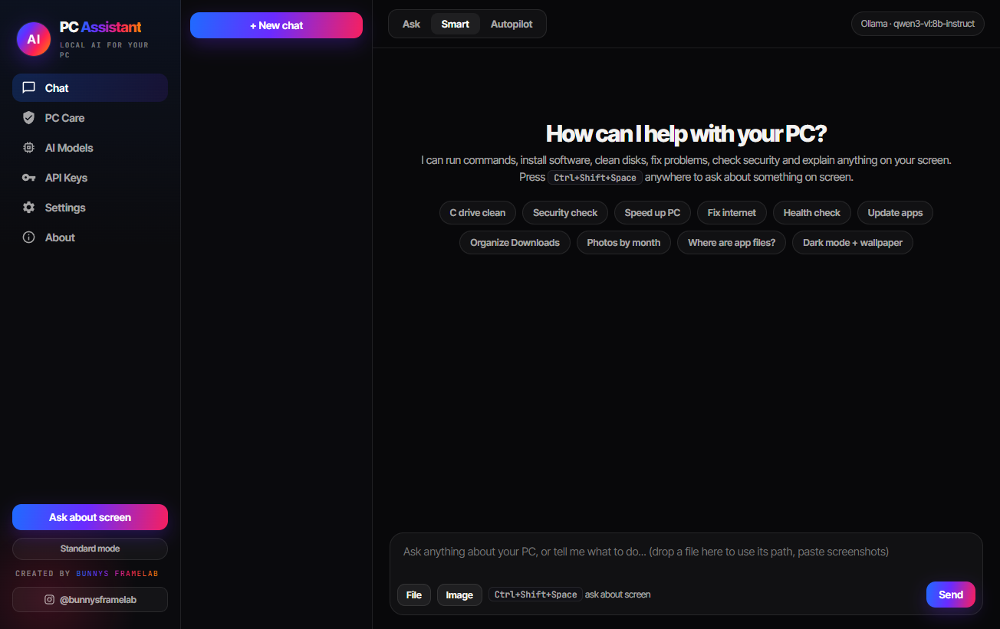

<h1 align="center">PC Assistant</h1>

<b>A local AI assistant that works on your own computer.</b> 
It fixes problems, runs terminal work, installs software, cleans and organizes files, checks security and explains anything on your screen. 
Windows and macOS · English, Bangla and Banglish · Created by <b>Bunnys Framelab</b>

<a href="https://github.com/uday629/PC-Assistant/releases/latest"><b>Download</b></a> ·
<a href="README.html">Full guide (HTML)</a> ·
<a href="https://www.instagram.com/bunnysframelab/">Instagram @bunnysframelab</a>

## What it is

PC Assistant is a desktop app with a chat window. Tell it what you need in your own words ("my C drive is full", "is my PC hacked?", "install this file", "sort my Downloads by type", "where are Photoshop's settings?"). It checks your computer, explains what it found in simple words, asks before anything risky, does the work and verifies it.

It runs on **local AI** through [Ollama](https://ollama.com), so it is private and free. It also works with your own API key for OpenAI, Claude, Gemini, OpenRouter, Groq, DeepSeek, Mistral, xAI and more.

## Why it was made

Everyone gets stuck on small computer problems: a full drive, an app that will not install, an error message, a setting they cannot find, a fear of being hacked. PC Assistant is the friend who "knows computers": it sees the problem, explains it and fixes it with your permission, on your own machine, in your language.

## Features

| | |
|---|---|
| **Chat that does the work** | Runs PowerShell (Windows) or zsh (Mac) commands, reads and edits files, changes settings and code |
| **Ask about your screen** | `Ctrl+Shift+Space` anywhere, select the part you do not understand, then **Explain**, **Guide me** or **Do it for me** |
| **Install anything** | Drop an exe / msi / dmg / pkg / zip. It checks the file and its signature, then installs. Knows winget and Homebrew |
| **Clean the drive** | Temp files, caches, update leftovers, old installers... shows what is safe and what you would lose, cleans only what you approve |
| **Organize files** | By type (images, screenshots, videos, documents...), by month and year, or your own rules. Preview first, undo anytime |
| **Security check** | Antivirus, firewall, startup items, background tasks, open ports, remote access, proxy, hosts file - explained and fixed |
| **App help** | Finds where an app is installed and where it keeps settings and files, then gives exact steps |
| **Look and settings** | Wallpaper, dark/light mode, transparency, and the right settings page with guidance |
| **Web research** | Built-in private browser search with source links |
| **Models in one click** | Install Ollama, 47 ready models with "fits your GPU" hints, import existing .gguf files or model folders |
| **You stay in control** | Ask / Smart / Autopilot modes, extra confirmation for critical actions, `Ctrl+Shift+X` emergency stop |

## Install

### Windows 10 / 11
1. Download `PC-Assistant-Setup-1.2.0-windows.exe` from the [latest release](https://github.com/uday629/PC-Assistant/releases/latest).
2. Run it. If Windows says "Windows protected your PC", click **More info → Run anyway** (the app is not code-signed yet).
3. Choose a folder and install.

### macOS (13 Ventura or newer recommended)
1. Apple menu → About This Mac: "Apple M..." chip → download `PC-Assistant-1.2.0-mac-arm64.dmg`; "Intel" → `PC-Assistant-1.2.0-mac-x64.dmg`.
2. Open the dmg and drag **PC Assistant** to **Applications**.
3. First start: right-click the app → **Open** → **Open** (it is not notarized by Apple yet). Or System Settings → Privacy & Security → **Open Anyway**.
4. Allow **Screen Recording** (for screen questions) and, if you want it to click and type for you, **Accessibility**.

### Set up the AI (one time)
- **Local (free, private):** AI Models → *Download and install Ollama* → download `qwen3-vl:8b-instruct` (8 GB+ GPU or 16 GB Mac) or `qwen3-vl:4b-instruct` (smaller computers) → **Use**.
- **Cloud:** API Keys → choose a provider → paste your key → **Add and test** → click a model.

## Safety and privacy
- With local AI nothing leaves your computer except the web searches the assistant makes.
- Risky actions show an Approve card with the exact command; you can edit or deny them.
- Deletes go to the Recycle Bin / Trash, organizing can be undone, edited files get a `.bak` copy.
- Web pages are read in a locked private browser that cannot download or reach your local network; after reading web content, risky actions always ask you.
- API keys are encrypted by Windows DPAPI / macOS Keychain.
- If you choose a cloud AI provider, your messages, the screenshots you send and basic computer details (computer name, user folder path) go to that provider.
- Use it only on computers you own or manage.

More screenshots, a Bangla quick guide, FAQ and uninstall steps are in **[README.html](README.html)** (download it and open it in your browser).

---

<b>Created by Bunnys Framelab</b> · <a href="https://www.instagram.com/bunnysframelab/">Instagram @bunnysframelab</a> Free to download and use. See <a href="LICENSE">LICENSE</a> for the terms.

